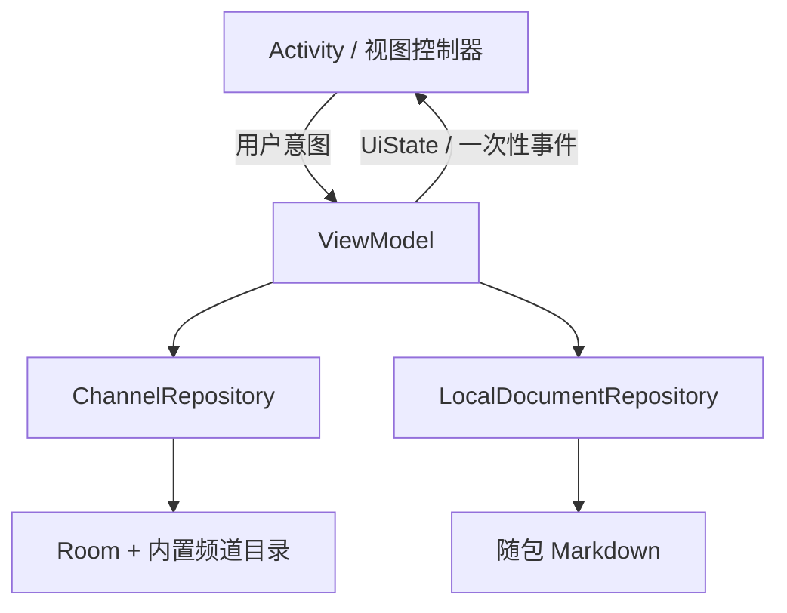

# 技术设计

更新日期：2026-11-11。

本文描述电视工坊当前源码的结构和行为，供开发、排查和评审使用。带日期的审查过程、取舍和历史检查见[工程变更记录](IMPLEMENTATION_HISTORY.md)，内置频道地址与抽样证据见[内置频道与来源记录](CHANNEL_SOURCES.md)。文中路径均相对于仓库根目录。

实现说明来自源码与静态核对，构建、测试、Lint 和设备验证的范围分别记在工程变更记录中。历史检查只适用于记录中注明的时间和修订。

## 1. 工程边界

| 项目 | 当前约定 |
| --- | --- |
| 模块 | 单 `:app` 模块，`settings.gradle.kts` 只包含 `:app` |
| 包名 | namespace 与 application id 均为 `com.sugar.tv` |
| UI | Kotlin + Android View/XML + ViewBinding + Material 3；不使用 Compose |
| 架构 | MVVM；Activity 负责生命周期和渲染，ViewModel 负责状态，Repository 负责数据访问 |
| 导航 | 显式 `Intent`；没有 Navigation 组件库 |
| 网络 | 订阅下载使用 `HttpURLConnection`；不引入 OkHttp、Retrofit、Gson、Coil 或 Glide |
| 序列化 | 信号源使用 `org.json`，持久化格式由 `SourceCodec` 固定 |
| 文档 | Markwon core 4.6.2 渲染随包 Markdown；`docs/` 打包，`project-docs/` 不打包 |
| 最低系统 | Android 10（API 29） |

### 1.1 构建与依赖

| 项目 | 版本或配置 | 来源 |
| --- | --- | --- |
| Android Gradle Plugin | 9.5.1，使用内置 Kotlin，不添加 `kotlin-android` 插件 | `gradle/libs.versions.toml` |
| Gradle Wrapper | 9.6.1 | `gradle/wrapper/gradle-wrapper.properties` |
| KSP | 2.3.13，仅用于 Room 编译器 | `app/build.gradle.kts` |
| SDK | min 29 / target 37 / compile 37 | `app/build.gradle.kts` |
| 应用版本 | versionName `1.0` / versionCode `1` | `app/build.gradle.kts` |
| Java | 11 `compileOptions`；AGP 运行环境要求 JDK ≥ 17 | 构建脚本和 AGP 说明 |
| 关键库 | Media3 1.11.1、Room 2.8.5、Material 1.14.0、AppCompat 1.8.0、Lifecycle 2.11.0、Coroutines 1.11.0 | `gradle/libs.versions.toml` |
| Release 优化 | `optimization { enable = false }`，未启用 R8 | `app/build.gradle.kts` |

依赖升级的日期、原版本和核对范围见[工程变更记录](IMPLEMENTATION_HISTORY.md#2026-11-08稳定依赖升级)。

## 2. 架构与职责



- `TvApplication` 通过 `by lazy` 持有全局唯一的 `ChannelRepository`，供浏览与播放 ViewModel 使用；`LocalDocumentViewModel` 创建使用 Application 的 `LocalDocumentRepository`。ViewModel 均不保存 Activity、View、Binding 或 Dialog。
- `BaseActivity` 在 `super.onCreate` 前调用 `enableEdgeToEdge()`。
- 页面由 `MainActivity`、`PlayerActivity`、`ChannelManagerActivity`、`AboutActivity` 和 `LocalDocumentActivity` 承担。除 Launcher 外，Activity 均为显式导航且 `exported=false`。
- 播放页使用 `sensorLandscape`、`singleTop` 和 `configChanges` 接管旋转；不通过重建页面初始化播放器。
- 一次性提示使用 `Channel`，页面在 `repeatOnLifecycle(STARTED)` 中收集；页面状态使用不可变 UiState 和只读 `StateFlow`。

### 2.1 包结构

| 包 | 主要职责 |
| --- | --- |
| `com.sugar.tv` | `TvApplication` 和主页入口 |
| `com.sugar.tv.base` | edge-to-edge 基类 |
| `com.sugar.tv.browse` | 主页 UiState、搜索、列表适配器和导入输入框 |
| `com.sugar.tv.data` | `ChannelRepository`、HTTP 地址校验、信号源 JSON 编解码 |
| `com.sugar.tv.data.builtin` | `BuiltinChannels` 内置目录 |
| `com.sugar.tv.data.db` | Room 数据库、实体和 DAO |
| `com.sugar.tv.data.m3u` | 无 IO 的 m3u / m3u8 解析器 |
| `com.sugar.tv.data.model` | `Channel`、`ChannelSource`、`ChannelCategory` 等业务模型 |
| `com.sugar.tv.player` | 播放页、播放状态和同页选台控制器 |
| `com.sugar.tv.manage` | 频道管理页、文件选择、导入频道列表与观看记录清理 |
| `com.sugar.tv.about` | 关于页、离线文档读取、Markdown 排版和章节动画 |

## 3. 页面、窗口与 Insets

### 3.1 主页

主页列表铺满窗口，`clipToPadding=false`。Toolbar 与分类 Chip 组成半透明浮层；根容器负责左右系统栏和挖孔，浮层顶部避让状态栏，列表顶部留白跟随浮层实际高度更新。加载、空态和列表位于浮层下方的可滚动区域，底部 padding 使用导航栏和 IME 的较大值并保留 16dp。

首次渲染保留 RecyclerView 恢复的位置，后续切换分类才回顶。列表启用 `PREVENT_WHEN_EMPTY`、固定尺寸和增量 Diff；频道名最多两行，摘要允许换行。

### 3.2 播放页

播放页使用纯黑背景和浅色系统栏图标，顶底操作区使用黑色渐隐遮罩，中央画面不压暗。常用入口固定为上一频道、频道列表、下一频道，线路、画质和画中画放入设置菜单。操作区通常 3 秒无操作后 200ms 淡出并向边缘轻移，完全隐藏后设为 `INVISIBLE` 以保留布局尺寸，并退出无障碍遍历。

错误区、设置菜单、持续触摸、键盘／遥控器焦点和读屏触摸浏览期间不会自动隐藏；窗口失焦暂停计时。方向键可以唤出操作区，错误态不允许手动隐藏。系统栏默认沉浸隐藏，边缘滑动可以临时唤出，按钮安全区不随临时系统栏移动。

设置根菜单与线路／画质／画面模式／睡眠定时子菜单统一使用固定深色背景，文字、箭头和单选标记使用浅色，禁用项使用次级色。观看设置始终有可用动作，单线路或不支持画中画的设备仍保留设置入口。`ThemeOverlay.TvWorkshop.PlayerPopup` 继承 Material3 深色主题，并显式指定 `popupMenuBackground`、`popupMenuStyle` 和具体背景 drawable，避免浅色 Material 弹窗背景与白字混用。

### 3.3 关于与本地文档页

关于页和文档页使用 DayNight 信息卡，内容最大宽度 500dp。根容器按系统栏、挖孔和 IME 的并集设置绝对 padding，子 View 不重复避让；工具栏和章节导航固定，正文独立滚动。章节入口和按钮保留至少 48dp 触达区。

各页按绝对值设置 Insets，重复分发不累加。主页继续分发 Insets，供浮层、列表和状态区分别处理；播放、关于与文档页统一处理后返回 `CONSUMED`。文档阅读实现见第 9 节。

### 3.4 导入对话框

浮动标签保持简短，长说明独立换行，输入区显示 4～6 行且不截断正文。`PlaylistInputEditText` 仅在正文可滚动时阻止外层截走滑动，不接管点击、选择和编辑；对话框在短窗口下也可滚动。混合输入关闭自动填充和拼写建议，取消或销毁后释放 Binding。

### 3.5 频道管理页

主页溢出菜单通过显式 Intent 打开 `ChannelManagerActivity`。页面使用 DayNight、500dp 最大宽度，根容器统一避让系统栏、挖孔和 IME。固定工具栏提供可恢复搜索；统计、导入、导出、清空观看记录和空态均放进可滚动列表头部，短窗口不会被固定操作区挤掉内容。

列表由 `ConcatAdapter` 连接头部与 `ManagedChannelAdapter`，频道行按 id 做 Diff，显示分类与线路数，不显示完整 URL。点行播放，独立 48dp 删除按钮经确认删除。首次数据及 Diff 提交完成后才放行位置恢复，合法空列表也能恢复头部滚动位置。确认窗口、Snackbar 和 Adapter 都由页面销毁时释放。

## 4. 数据模型与 Room

数据库文件为 `tv_workshop.db`，schema version 为 1，`exportSchema=false`。内置目录不落库，导入频道保存在 Room；收藏和观看记录按频道 id 弱关联到“内置目录 ∪ 导入目录”。清空导入频道不会删除收藏或观看记录，列表映射时自动跳过已经消失的频道。

| 表 | 实体 | 关键字段 | 当前行为 |
| --- | --- | --- | --- |
| `favorite_channels` | `FavoriteChannelEntity` | `channelId` 主键、`addedAt` | `toggle` 使用 DAO 单条事务；观察流按 `addedAt DESC` 返回 id。 |
| `recent_channels` | `RecentChannelEntity` | `channelId` 主键、`watchedAt` | 播放请求写入并覆盖时间；观察流按 `watchedAt DESC` 返回 id；管理页可清空全部记录。 |
| `imported_channels` | `ImportedChannelEntity` | `id` 主键、`name`、`groupName`、`sourcesJson` | id 为 `m3u:` 加 SHA-256 前 12 位；按 `rowid ASC` 稳定读取；线路以 `SourceCodec` JSON 数组保存。 |

网络、序列化或反射使用的模型以及 Room 实体加 `@Keep`。`SourceCodec` 固定保存 `label`、`url` 字段组成的 JSON 数组，解码时跳过坏元素。修改 schema 或字段格式必须评估迁移和旧数据兼容，不能静默丢弃数据。

## 5. 主页数据流

1. `importedDao.observeAll()` 与 `BuiltinChannels.all` 合并。导入实体解码失败或没有合法 HTTP(S) 线路时丢弃；合并和索引在 `Dispatchers.Default` 执行。
2. 频道全集变化时重建 `channelsById`；收藏 id、最近观看 id 和收藏乐观覆盖只参与状态合成，不重复创建目录索引。
3. `BrowseViewModel` 将目录、收藏、最近观看、当前分类和已生效搜索词合成为不可变 `BrowseUiState`。搜索输入写入侧 250ms 去抖，清空立即生效；状态流使用 `WhileSubscribed(5_000)`。
4. “最近观看”按最近 id 顺序映射，“我的收藏”按收藏 id 顺序映射（最新在前），两者跳过已经删除的频道；其他分类按频道分类过滤；搜索为忽略大小写的名称包含匹配。收藏分类复用原有乐观更新与写入门禁，空态使用专门收藏文案。
5. 收藏点击先写入带代次的内存覆盖，再由 Mutex 按点击顺序提交 Room；等待数据库观察流确认，宽限 1 秒。只有创建该覆盖的请求可以释放它，旧请求不会覆盖后续点击；失败时回滚。
6. `MainActivity` 只负责收集状态、提交列表、同步 Chip、显示 Snackbar 和导航。加载、空态、列表三种视图互斥；导入成功或清空结果通过事件通道显示。

`SavedStateHandle` 使用 `browse_selected_category` 和 `browse_active_query` 保存当前分类、去抖后的搜索词。恢复值进入初始 UiState，搜索监听在回填后再绑定；分类 Chip 不单独保存选中态。列表只在结果变化时提交，Snackbar 同一时刻只保留最新一条。

## 6. m3u 解析与导入

### 6.1 解析规则

`M3uParser` 是无 IO 的纯逻辑，调用方在 IO 或 Default 调度器执行。

- 每行先 `trim` 并移除 BOM；空行和普通 `#` 注释跳过，`#EXTM3U` 不强制存在。
- `#EXTINF` 属性支持 `tvg-id`、`tvg-name` 和 `group-title`。频道名取首个不在双引号内的逗号之后的文本；为空时回退 `tvg-name`，仍为空则丢弃。
- 连续的 `#EXTINF` 可以共用后面的一个 URL；没有元数据的裸 URL 也会解析。
- URL 必须是带合法主机和端口的 HTTP(S)，兼容大小写 scheme 与 IPv6，拒绝缺主机、越界端口和 `http:xxx`。
- 裸 URL 的名称取最后一个非空路径段（去扩展名，`index` 特判），否则取主机名；分组为空。
- 分类规则按顺序判断：名称或分组含“央视／CCTV／CNTV／CGTN”→央视；含“卫视”→卫视；含 CJK 统一表意文字（U+4E00–U+9FFF）→自定义；其余→外国频道。
- 导入 id 为 `m3u:` 加 `SHA-256(名称 + "\n" + 首个新 URL)` 的前 12 位小写十六进制。
- `tvg-id` 和 `tvg-name` 只存在于临时解析对象，不写入导入表，没有 EPG 功能。

属性正则只编译一次，摘要前 6 字节直接编码为 12 位 ASCII 小写十六进制，保持现有 id 格式并减少重复分配。

### 6.2 输入分流

主页“导入频道源”接受两类粘贴输入；本地文件入口见第 6.4 节：

- 单行、以 `http://` 或 `https://` 开头的地址（忽略大小写）：通过 `HttpURLConnection` 下载并逐行解析；
- 其他输入：作为列表正文解析，支持多行裸 URL。

下载使用 GET，连接和读取超时各 10 秒，非 2xx 响应抛出 `IOException`，连接在 `finally` 中断开。字符集优先使用响应头的 `charset`，兼容大小写参数名、引号和后续参数，无法识别时回退 UTF-8。

下载正文逐行喂给解析器，不把原始订阅全文驻留内存；解析结果和合并结构仍会在导入期间全量保留。对话框的输入和滚动规则见第 3.4 节。

### 6.3 合并、去重与保存

`ChannelRepository.importEntries` 在 `Dispatchers.IO` 执行：

1. 空结果或没有可播放频道时抛出 `IllegalArgumentException`；
2. 在本次批次内按“名称去空白并转小写”合并同名频道，分组取首个非空值，线路用 `LinkedHashSet` 保序去重；
3. 为内置目录预建“名称 → 已固化地址”索引，剔除同名条目中的已存在地址；全部重复则跳过，仍有新地址则创建独立导入频道，不修改内置频道；
4. 组装 `ImportedChannelEntity`，线路标签写成“线路N”；
5. 通过 DAO 的 `INSERT IGNORE` 写入，按真实插入行数统计新增数，不预读所有旧实体正文。

导入是一次性快照：不保存订阅 URL，不定时刷新；已有 id 直接跳过，即使其他线路发生变化也不会更新。名称写法或首个新地址变化可能产生新 id。“清空自定义频道”实际删除导入表全部记录，不影响收藏和观看记录。

`IllegalArgumentException` 映射格式错误，`IOException` 映射网络不可用，其他异常显示通用失败；`CancellationException` 原样上抛。合并循环与提交前检查取消，但阻塞网络读取仍受超时约束，不保证立即中断套接字。

导入进行中拒绝重复触发并禁用按钮。结果通过 `BrowseEvent` 显示，成功关闭对话框，失败保留输入，取消或页面销毁时清除 Binding，避免持有大体积正文。

### 6.4 本地文件与导入频道管理

`ChannelManagerViewModel` 合成导入频道、全部最近观看 id、搜索词与操作进度，过滤在 Default 执行，状态流使用 `WhileSubscribed(5_000)`。只在 `SavedStateHandle` 保存查询词。页面所有管理操作共用 ViewModel 的写入门禁，防止该页并行删除、导入或导出；取消异常原样上抛，其余失败通过通道提示，不输出异常详情或 URI。

- `OpenDocument` 按次授权选择文件，兼容未标注正确 MIME 的 m3u 文件。仓库用 Application 的 `ContentResolver` 在 IO 调度器读取 UTF-8 流，关闭流后复用 `importEntries`，保留既有分类、合并和幂等规则。不保存 URI、不请求持久授权，也不自动同步文件。
- `CreateDocument("audio/x-mpegurl")` 建议文件名为 `tv-workshop-channels.m3u`。用户先确认完整 URL 可能含令牌，再选择保存位置。仓库用单条查询取得全部导入实体的有序快照，解码有效线路后交 `M3uWriter` 写入；只有流成功关闭才提示导出频道数，按导入身份计数，不按名称或线路数计数。搜索不限制导出范围。
- `M3uWriter` 输出 `#EXTM3U`，每路地址独立输出 `#EXTINF` 和原样 URL。分组双引号替换为单引号，元数据换行替换为空格，拒绝含换行的地址，防止元数据成为额外指令。它不持久化未保存的 EPG 字段，不导出内置频道、收藏、历史或音视频。重新导入仍按名称合并，不能当作数据库完整恢复。
- 单频道删除调用原有 `removeImportedChannel`，只删除目标导入身份；保留收藏和历史弱关联。清空历史使用 `RecentChannelDao.deleteAll`，包含已删除频道留下的记录，不触碰收藏或导入表。两项操作均先确认。

Room schema 仍为 version 1，没有修改实体或引入迁移。系统文件提供器可能是云盘；文件 IO 失败可能留下不完整输出文件，由用户管理目标位置。解析结果和导出快照仍全量驻留内存，超大文件峰值未实测。

## 7. 播放器与信号源轮换

### 7.1 生命周期与创建

ExoPlayer 实例由 `PlayerActivity` 持有：

- `onStart` 调用 `ensurePlayer()`，创建或复用实例后显式渲染当前 UiState；
- `onStop` 和 `onDestroy` 释放实例，先解除 PlayerView／Surface 关联并重置应用请求标记；
- 画中画仍属于可见前台，`onStop` 在 `isInPictureInPictureMode` 为 true 时保留播放器；
- 其他退后台场景释放播放器，回前台后按当前状态重新装载线路。

创建配置使用 `USAGE_MEDIA`、`AUDIO_CONTENT_TYPE_MOVIE`、音频焦点和拔耳机暂停。`DefaultLoadControl` 起播阈值为 1500ms、重缓冲阈值为 3000ms，最小／最大缓冲为 15s／30s；为短时抖动保留更多余量，代价是可能增加首次出画和卡顿后的等待。Media3 还会按目标直播延迟的一半限制起播与恢复阈值，不能假定始终积累到配置时长。参数调整没有形成实测改善结论。扩展渲染器关闭，启用 `setEnableDecoderFallback(true)`；设备是否有可用备用解码器由设备决定。

### 7.2 播放请求与换台

ViewModel 只决定“应播放哪一路”，播放器实例由 Activity 管理。主页传入 `EXTRA_CHANNEL_ID`，与 `EXTRA_SOURCE_INDEX` 共用恢复键；`resolveStartIndex` 校正起始线路并写回 `SavedStateHandle`。

`playRequestId` 每次换频道、换源或重试递增，写入 `MediaItem.mediaId`。缓冲、轨道和错误回调通过 `AnalyticsListener.EventTime` 所属时间线读取序号，不能读取播放器当前媒体替旧事件重新贴标签；ViewModel 再核对当前代次。重试可能只改变序号，因此 Activity 以序号而非线路下标判断是否重装。释放播放器时将 `appliedPlayRequestId` 重置为 -1，供前台状态重放。

换频道按全集顺序循环回绕。快速连续点击以上一次请求的目标频道为基准，旧加载 Job 先取消；新频道从第一路开始，同频道重复加载不重新起播。频道缺失或无源时清空旧媒体，避免错误态继续播放旧画面。

查询结果写回前核对 `latestRequestedChannelId`，只有最新选择更新状态和观看记录。记录写入失败不打断播放；播放页收藏图标只认仓库观察流，写入返回值仅用于提示。

对 `.m3u8`／`.m3u` 路径显式声明 `MimeTypes.APPLICATION_M3U8`，带查询串时仍能识别；其他地址交由 ExoPlayer 自动判断。换频道、换源和重试复用同一播放器，通过 `setMediaItem + prepare + play` 切换。

### 7.3 失败、换源和重试

普通 `STATE_BUFFERING` 只更新加载指示，可恢复的分片加载错误由 Media3 自行处理，不会直接换源。只有致命 `onPlayerError` 才进入 ViewModel 的恢复流程：

1. `ERROR_CODE_BEHIND_LIVE_WINDOW` 表示播放位置已落到直播列表保留窗口之外，先保持频道和线路，创建一个新请求，从源的默认直播位置重新接入；
2. 同一恢复请求再次失败时不再原地重接，其他致命错误也直接顺序尝试后续线路；
3. 最后一路失败后进入 `allSourcesFailed`，停止顺序轮换，并延迟 8 秒自动重试当前线路，最多 2 次。

原线路重接不消耗末路的延迟重试计数；新的手动请求、换源或延迟重试各自允许一次直播窗口恢复，仍受末路重试上限约束。若从中间线路恢复，前面的线路可能没有尝试；`allSourcesFailed` 不表示已经遍历所有线路。

换频道和手动重试会取消待执行重试并归零计数；手动换源取消任务但保留计数。手动换源循环切换，能够从错误态恢复。`retry` 在频道缺失或无源时重新查询，否则保持下标重试当前线路。

线路菜单校验媒体请求代次和当前线路；正常播放时重复选择同一路不重装媒体。无源不显示线路计数，单路线路禁用选择入口；错误区只有在至少两路时显示一步换源操作。错误内容在上下操作区之间滚动，操作区在错误态保持可见。

媒体请求、画质选项或偏好变化会关闭旧菜单；退后台、进入画中画同时关闭根菜单和独立子菜单。选台期间只显示简短错误，关闭面板后恢复完整重试操作。

### 7.4 清晰度

`onTracksChanged` 只保留受支持的视频格式，按高度去重并在同高度保留最高码率；装载期的 `Tracks.EMPTY` 不清除既有偏好。少于两种真实高度时隐藏画质入口，但保留单档信息用于校验。

模式为：

- **自动**：带宽自适应；
- **最高**：使用 `setForceHighestSupportedBitrate`；
- **高度上限**：使用 `setMaxVideoSize`，在上限内继续自适应。

新线路没有原选高度时回落自动并解除旧限制；用户选择和自动回落都会递增 `qualityRequestId`。创建新播放器时立即应用当前偏好。

### 7.5 手势、操作区和画中画

播放区单击经约 300ms 确认后通过 `performClick` 切换操作区，保证触摸、TalkBack 和键盘行为一致。正常观看时，双击左／右半区分别换台；横扫需要满足速度和横纵比条件，右扫上一台、左扫下一台。

操作区隐藏且频道变化时，在顶部起始边缘显示最多 320dp 的频道提示，1.5 秒后淡出；操作区出现即清理提示。选台预览单击关闭面板，不执行双击或横扫换台。

画中画入口只在设备支持时显示，以 16:9 画幅进入。进入画中画时关闭选台面板、设置菜单和 OSD，覆盖层隐藏但播放器继续工作；退出时恢复顶底栏并重新计时。能力检查失败不会打断前台播放。

### 7.6 卡顿与换源排查

调试包通过 `PlayerDiagnostics` 向本机 Logcat 输出 `TvPlayback` 标签。在 Android Studio 选择应用进程后，用 `tag:TvPlayback` 筛选，从一次 `source_request` 开始保留到卡顿、错误及下一次请求；正式包不输出这些诊断。不另存日志、不上报，不记录频道名、URL、请求头、异常消息或堆栈。

| 事件或字段 | 排查用途与边界 |
| --- | --- |
| `source_request`、`request`、`source` | 关联媒体请求与线路序号；同一下标的新请求也可能是重试或前台恢复 |
| `buffering`、`ready`、`waitMs`、`bufferedMs` | 区分首次接入与再次缓冲，观察等待时长和剩余媒体；缓冲本身不是换源原因 |
| `load_error`、`httpStatus`、异常类别 | HTTP 403／404／5xx、连接失败和超时帮助定位网络或服务端问题；单次加载错误不一定导致播放失败 |
| `player_error`、`code` | 致命错误触发恢复或换源；直播窗口落后、网络、解析、解码错误需要分别看待 |
| `video_format`、`bandwidthBps` | 对照实际格式码率与播放器带宽估计；估计值不能证明持续下载能力 |
| `dropped_frames`、`audio_underrun` | 若缓冲仍充足，应进一步检查编码、解码和渲染负载，不直接归因于地址失效 |

日志提供排查线索，不能只凭截图、存在 URL、调大缓冲或出现自动换源就判定责任。需结合出现问题时的网络、设备与连续日志复现；此轮没有运行设备任务或重新请求直播地址。

### 7.7 画面模式与睡眠定时

`PlayerViewingOptions` 与媒体 UiState 分离，经独立 StateFlow 暴露。`VideoDisplayMode` 的 FIT／ZOOM／FILL 分别映射 `AspectRatioFrameLayout` 的完整显示、等比裁切和拉伸模式，仅改变 `PlayerView.resizeMode`，不重建播放器或递增媒体请求。模式按枚举名存入恢复句柄，在当前播放页会话内跨频道保留。

睡眠定时提供 15、30、60、90、120 分钟和关闭。重新选择时长从当前时刻重新计时，换台、自动换源和手动重试不重置。正常运行使用 `SystemClock.elapsedRealtime`；恢复句柄保存墙上时钟截止值、选择时长和已到期标记，进程恢复时换算剩余时长并限制为最长 120 分钟。进程恢复时调整过系统时间可能改变剩余值，运行中改时间不改变单调时钟截止值。

页面在 STARTED 收集观看状态，标签随操作条显示；一个页面级秒级回调独立核对截止时间，画中画和普通后台仍可处理到期，在销毁时移除。分钟数不变时不重新赋值 TextView。到期先取消待执行重试和频道加载、保持过期标记，再关闭菜单、释放播放器、解除常亮并退出播放页。`onStart` 在 `ensurePlayer` 前核对截止值，过期恢复不能短暂重新开播。

这是播放页会话计时，不创建闹钟、通知或后台服务；进程结束后没有额外唤醒机制，媒体也随进程结束。主动离开播放页结束会话，新开播放页默认完整显示且未启用定时。`SleepTimerTest` 覆盖恢复与取整边界，运行时验证范围见工程记录。

## 8. 同页选台

### 8.1 布局与退出

频道列表与视频是根布局的兄弟节点。可用宽度至少 600dp 时，列表在末端占 280～320dp，RTL 下随末端方向调整；窄窗口为视频在上、列表在下，预览以 16:9 为目标并限高到可用高度三分之一，为搜索和频道行留出空间。

搜索框与关闭按钮同排，打开时不主动弹键盘，禁用横屏全屏输入模式。根布局配合 `adjustResize` 统一处理系统栏、挖孔和 IME，按剩余空间重排；列表始终不覆盖视频。

面板打开后隐藏操作区和换台提示。点击频道、关闭按钮、系统返回或点击预览恢复全屏，不重建播放器，也不重新装载当前媒体。进入画中画时关闭面板并恢复全尺寸视频；普通退后台仍遵循释放和回前台重装载规则。

### 8.2 状态与列表时序

`PlayerChannelsPanelController` 只管布局、列表和焦点，业务开关和原始查询归 `PlayerViewModel.channelPanelState`。`SavedStateHandle` 只保存 Boolean 和 String；主动重开清空查询并定位当前频道一次，重建和前后台保留查询与列表位置。

面板可见且页面处于 `STARTED` 时才收集 `channelPanelRows`，查询变化用 `collectLatest` 取消旧流。过滤、映射和相等性检查在 Default 执行，隐藏和退后台不持续合成结果。

列表使用稳定频道 id、`PREVENT_WHEN_EMPTY`，关闭条目动画。相等结果不重复提交；快速清空时仍推进提交代次，使旧 Diff 作废。定位回调核对查询、开关、Adapter 和销毁状态；用户开始拖动后，迟到定位不再打断滚动。

### 8.3 焦点与无障碍

面板固定深色，频道名最多两行，当前项同时提供图标、高亮和读屏状态。键盘／遥控器关闭面板后回到频道列表入口，触摸关闭不强制保留按钮焦点。控制器销毁时移除布局、滚动和输入监听并解除 Adapter。

## 9. 关于页与离线文档

### 9.1 入口与正文来源

主页菜单“关于”打开 `AboutActivity`，显示 `BuildConfig` 中的版本号，并链接到三个随包 Markdown：

| 文档 | 维护源 | 页面规则 |
| --- | --- | --- |
| 版本更新日志 | [CHANGELOG.md](../docs/version-history/CHANGELOG.md) | 默认展开首项，各卡片独立展开，定位时展开目标 |
| 用户协议 | [USER_AGREEMENT.md](../docs/legal/USER_AGREEMENT.md) | 条款保持展开，章节胶囊可定位 |
| 隐私政策 | [PRIVACY_POLICY.md](../docs/legal/PRIVACY_POLICY.md) | 条款保持展开，说明数据、请求、备份和清理范围 |

`app/build.gradle.kts` 将根目录 `docs/` 配为 assets，仓库和 APK 使用同一份正文。README、AGENTS 和工程专题不打包；文档不下载线上版本。

### 9.2 后台读取与排版

`LocalDocumentRepository` 在 IO 调度器读取 UTF-8 Markdown，在 Default 调度器按一级标题、概述和二级章节拆分；三级及以下标题保留在章节正文中。Markwon core 4.6.2 只处理本地 Markdown，不启用网络图片插件。

后台渲染器用 Mutex 串行访问，重试先取消旧任务；UI 只执行 `setParsedMarkdown` 的 TextView 绑定钩子，补齐列表缩进等测量，不重新解析。各章 Span 一次性准备，正文 View 随列表回收，未做超长日志的逐版本懒排版。

### 9.3 状态与动画

`LocalDocumentViewModel` 暴露不可变 UiState，使用 `SavedStateHandle` 保存文档标识和展开下标 IntArray，不把正文放入 Bundle。进程重建从 assets 重载，显式空集合保留“全部收起”；RecyclerView 使用 `PREVENT_WHEN_EMPTY` 恢复阅读位置。

Adapter 使用稳定章节身份、ListAdapter 和 DiffUtil，关闭整行条目动画。每个 Holder 的 `DocumentSectionAnimator` 以 240ms 动画同步高度、透明度和箭头；反向从当前视觉进度接续。初始、恢复、离屏、宽度变化和系统关闭动画直接到目标状态；收起先退出焦点和读屏遍历，结束清链接并恢复 `wrap_content`。

章节定位等待提交、目标绑定、动画和布局稳定，连续导航只执行最新目标。滚动高亮当前章节，回顶定位概览，正文支持选择。销毁时结束动画、取消旧回调并解除列表和对话框引用。法律章节始终展开。

### 9.4 语言与链接

`LocalDocument` 枚举固定标识、中文标题和 asset 路径，未知参数回退用户协议。内部互链只接受登记的法律文件名；HTTP(S) 网页确认目标后交系统浏览器，没有浏览器时提示。点击回调在绑定时创建，后台结果不持有页面。

关于页与三份正文当前只提供简体中文，通用界面文案仍维护 11 个语言目录。应用内不使用 WebView，不增加账号、自动反馈或首次启动同意门禁。

## 10. 资源、主题与多语言

- `values/dimens.xml` 提供脚本生成的 `dp_1`～`dp_500`、`sp_1`～`sp_500`，以及语义别名 `browse_list_max_width`；XML 正整数尺寸引用资源，不直接写 `10dp` 等数值。
- `Theme.TvWorkshop` 使用 Material 3 DayNight；`values-night/colors.xml` 提供深色颜色；播放页使用纯黑窗口和浅色系统栏图标。
- 通用 string key 在 `values` 加 `values-en/ar/de/es/fr/ja/ko/pt/zh-rCN/zh-rTW` 共 11 个目录同步维护；当前各 84 个 key，28 个新功能 key 集中于 `strings_features.xml`，格式化文案使用位置占位符。关于页和三份随包文档的中文例外集中在 `values/strings_documents.xml`，并标记 `translatable=false`。
- selector、ripple、layer-list 等嵌套 drawable 的 item 不使用 `?attr`，直接引用颜色资源；根级 vector 的主题属性可以沿用 AppCompat 包装路径。
- 自适应图标为蓝色渐变背景、白色电视／天线／播放键前景，收在中央 66dp 安全区；`monochrome` 复用前景供 Android 13+ themed icon。没有密度 PNG，设计稿见 [tv-workshop-logo.svg](design/tv-workshop-logo.svg)。

## 11. 网络、隐私与已知限制

- Manifest 只声明 `INTERNET`，并以 `usesCleartextTraffic=true` 兼容 HTTP 订阅和直播地址；输入 URL 的查询参数按原样请求，可能包含令牌。
- 收藏、最近观看和导入频道保存在本机 Room；应用没有账号、统计、崩溃上报或开发者云同步。
- 用户主动导出时，导入频道的名称、分组和完整地址会写入用户选择的文档位置；文件可能含令牌，由用户和所选文件提供器管理。清理应用数据库不删除外部导出文件。
- `allowBackup=true` 且备份规则没有排除 Room，系统可能把数据纳入云备份或设备迁移；“本机保存”不等于数据永不离开设备。
- 播放和订阅请求会把 IP、请求地址和普通请求头交给第三方服务；其日志政策不由应用控制。
- 直播不承诺长期可用性、出画速度、画质或解码能力；源状态会变化，IPv6、地区和运营商限制可能影响结果。
- 导入下载逐行读取，但解析结果和合并结构仍全量保留；超大列表的峰值内存和耗时没有实测。
- `tvg-id`／`tvg-name` 没有持久化，EPG 尚未实现。独立收藏分类、本地文件导入导出和单个导入频道删除已经提供。
- 当前已有解析、导出、睡眠定时、Codec 和 DAO 回归测试源码，但本轮未运行。未运行的构建、测试、Lint 和设备验证不能由历史记录代替。

## 12. 验证与后续方向

项目默认不在文档编辑时启动 Gradle 或设备任务；用户明确要求工程验证时，根据范围执行：

```bash
./gradlew :app:assembleDebug
./gradlew :app:testDebugUnitTest
./gradlew :app:lintDebug
git diff --check
```

静态阅读、构建、测试、Lint 和设备实测需要分开报告。UI 变更至少按实际影响考虑浅深色、大字体、RTL、窄宽窗口、IME、系统栏、导航模式、进程重建、前后台切换和画中画。直播源可用性只能引用当次实测，不能从源码中存在某个 URL 推断。

自然的后续方向包括：EPG、信号源健康度和测速、内置源画质标注、来源记录补全，以及扩大 ViewModel 和播放器生命周期测试覆盖。以上均未实现。

历史审查的触发原因、修正细节和实际检查边界见[工程变更记录](IMPLEMENTATION_HISTORY.md)；频道来源、地址清理与内容抽样见[内置频道与来源记录](CHANNEL_SOURCES.md)。
